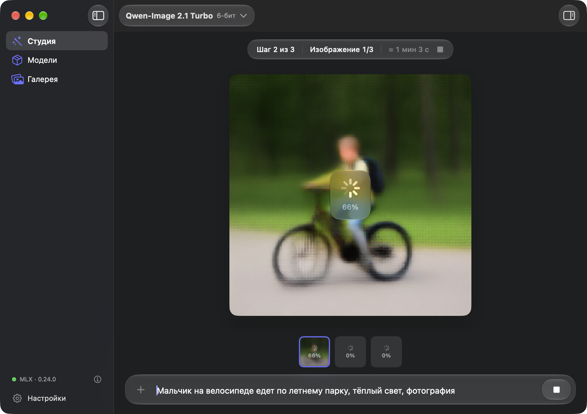
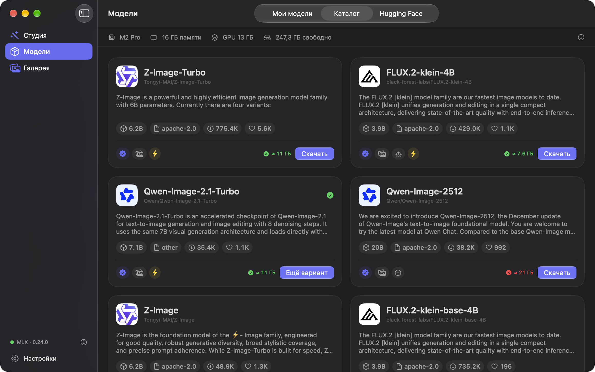
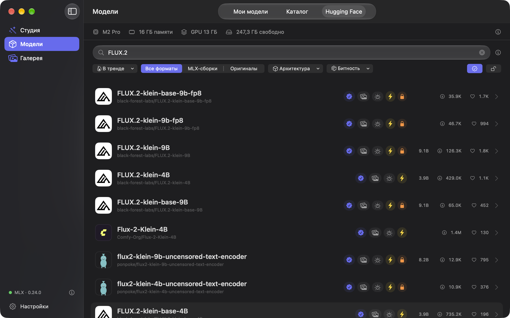

<h1 align="center">
  
</h1>

**English** · [Русский](README.ru.md)

[](https://github.com/D1ma-coder/LocalImage/actions/workflows/ci.yml)
[](https://github.com/D1ma-coder/LocalImage/releases)
[](#installation)
[](LICENSE)

LocalImage is a native macOS app that generates images entirely on your Mac. It is written in SwiftUI with Liquid Glass and uses [mflux](https://github.com/filipstrand/mflux) on Apple's MLX as the engine. Prompts, images and models never leave the computer. The interface is available in English and Russian and follows the system language.

You can download any compatible model from Hugging Face inside the app, choose how it is quantized, and watch every denoising step as it happens. The app is designed to work on a Mac with 16 GB of unified memory: it estimates the memory peak before each run and picks safe settings automatically.

**[Install](#installation) · [First image](#first-image) · [Models](#models) · [16 GB of memory](#16-gb-of-memory) · [Files](#where-files-are-stored) · [Build](#building-from-source)**

## Live preview

Every step shows an estimate of the finished image (x̂₀), not raw noise, so the composition is visible from the first step. The canvas stays slightly blurred under a loader until the image is final; a batch gets all its slots up front.



All images are saved to `~/Pictures/LocalImage/YYYY-MM-DD/` with a `.lix.json` file next to each one. The gallery searches by prompt and repeats any image with the same or a new seed.

## Installation

Builds are published to [Releases](https://github.com/D1ma-coder/LocalImage/releases) after building on CI:

| Platform | Archive |
|---|---|
| macOS 26 or later, Apple Silicon (M1 and newer) | `LocalImage-<version>-macos-arm64.dmg` |

1. Download the disk image and open it.
2. Drag **LocalImage** onto **Applications**.
3. The app is not signed with a Developer ID and not notarized, so macOS blocks the first launch. Either run

   ```sh
   xattr -dr com.apple.quarantine /Applications/LocalImage.app
   ```

   or open the app once, then click **Open Anyway** in **System Settings → Privacy & Security**.

SHA-256 checksums are listed in each release description. Intel Macs are not supported: MLX runs only on Apple Silicon.

## First image

1. **Install the engine.** On first launch the app offers to install it. [uv](https://github.com/astral-sh/uv) creates an isolated Python 3.12 environment with a pinned `mflux==0.24.0` in `~/Library/Application Support/LocalImage/engine`. If uv is not installed, the app downloads it from its GitHub releases. Nothing is installed system-wide.
2. **Download a model.** Open **Models → Catalog**. Z-Image Turbo (4-bit) or FLUX.2 klein 4B are good first choices for 16 GB.
3. **Generate.** Return to **Studio**, type a prompt and press **⌘↩**. **⌘.** stops instantly, **⇧⌘R** sets a new seed.

To start from an existing picture, drag it onto the canvas or press **+** next to the prompt; **Source influence** in the right panel controls how much of it is kept.

## Models

- **Catalog.** Open models with ready MLX builds (4/8-bit) from [mflux-community](https://huggingface.co/mflux-community): Z-Image, FLUX.2 klein, Qwen-Image 2.1, ERNIE-Image, Boogu, MOSS-Image, Iris, Anima and others. Descriptions, licenses, parameter counts and download numbers are loaded from Hugging Face.
- **Hugging Face search.** Any repository, with filters by format (MLX build / original), architecture, bit width, compatibility and gated access. Icons on each row explain themselves on hover.
- **Original weights with your own quantization.** The text/VL encoder and the diffusion model are quantized separately. The app suggests the best combinations for the memory of your Mac.
- **Downloads** resume over HTTP Range after network errors and app restarts, one file at a time. Only the needed weights are downloaded; duplicate single-file checkpoints and repository images are skipped.



<details>
<summary>Hugging Face search</summary>



</details>

A Hugging Face token is optional. Enter it in **Settings → Hugging Face**: it is checked as you type and is needed only for gated models and higher API limits. It is stored in `~/Library/Application Support/LocalImage/hf_token` with mode 600, not in the Keychain.

## 16 GB of memory

- MLX loads weights lazily, and the text encoder is unloaded before drawing starts, so the encoder and diffusion peaks do not add up.
- The memory estimate in the right panel uses Metal's GPU working-set limit for this Mac.
- On M1/M2 the app computes in float16, which is about 27% faster on an M2 Pro.
- Low-memory mode (mflux `--low-ram`) turns on automatically when the estimated peak is close to the limit.
- Generation and quantization never run at the same time.

Measured on an M2 Pro with 16 GB, Z-Image Turbo 4-bit, 768×768, 9 steps: 7.3 s/step in float16 (10.2 s/step in bfloat16), MLX peak 4.6 GB.

## Where files are stored

| What | Where |
|---|---|
| Engine | `~/Library/Application Support/LocalImage/engine` |
| Models | `~/Library/Application Support/LocalImage/models` (can be changed in **Settings → Folders**) |
| Images | `~/Pictures/LocalImage` (can be changed in **Settings → Folders**) |
| Hugging Face token | `~/Library/Application Support/LocalImage/hf_token` |
| Step previews | `$TMPDIR/LocalImagePreviews` |

## How it works

```
LocalImage/
  App/        entry point, AppModel
  Core/       paths, hardware (Metal working set, GPU cores), HF token, formatting
  Engine/     Engine (uv / venv / mflux setup), Worker (process and events)
              lix_worker.py — bridge to mflux, bundled in the app resources
  Models/     catalog, memory model and quantization advice, Hugging Face client
  Downloads/  FileTransfer (Range resume), ModelStore (manifests, queue, quantization)
  Studio/     generation settings, jobs, progress and time estimate, gallery
  Views/      SwiftUI
```

The Swift app starts `python -I lix_worker.py <command> <json>` for each job. Memory is fully released after the job, a crash in a model cannot take down the interface, and cancelling is a signal to the worker process. A batch of images is generated with a single model load.

The worker writes JSON lines (`phase`, `denoise`, `step`, `preview`, `image`, `done`, `error`, `log`) to its original stdout; mflux and tqdm output goes to stderr and becomes the log. On top of mflux it adds an in-loop preview callback that decodes x̂₀ = x − σ·(Δx/Δσ), per-component quantization (text / image / VAE), and a `families` command that reports what each architecture supports, so the interface adapts to every model.

mflux is pinned because the worker uses its internal APIs. Before upgrading, run `python lix_worker.py families` and a short test generation.

## Building from source

Requirements: Xcode 26 or later on Apple Silicon.

```sh
git clone https://github.com/D1ma-coder/LocalImage.git
cd LocalImage
xcodebuild -project LocalImage.xcodeproj -scheme LocalImage -configuration Release \
  -derivedDataPath build/DerivedData build
open build/DerivedData/Build/Products/Release/LocalImage.app
```

Or open `LocalImage.xcodeproj` in Xcode and press **⌘R**. New files under `LocalImage/` are picked up automatically.

## License

[MIT](LICENSE). mflux is distributed under the MIT license. Every model has its own license, shown in the catalog and on its Hugging Face page; check it before using generated images commercially.
