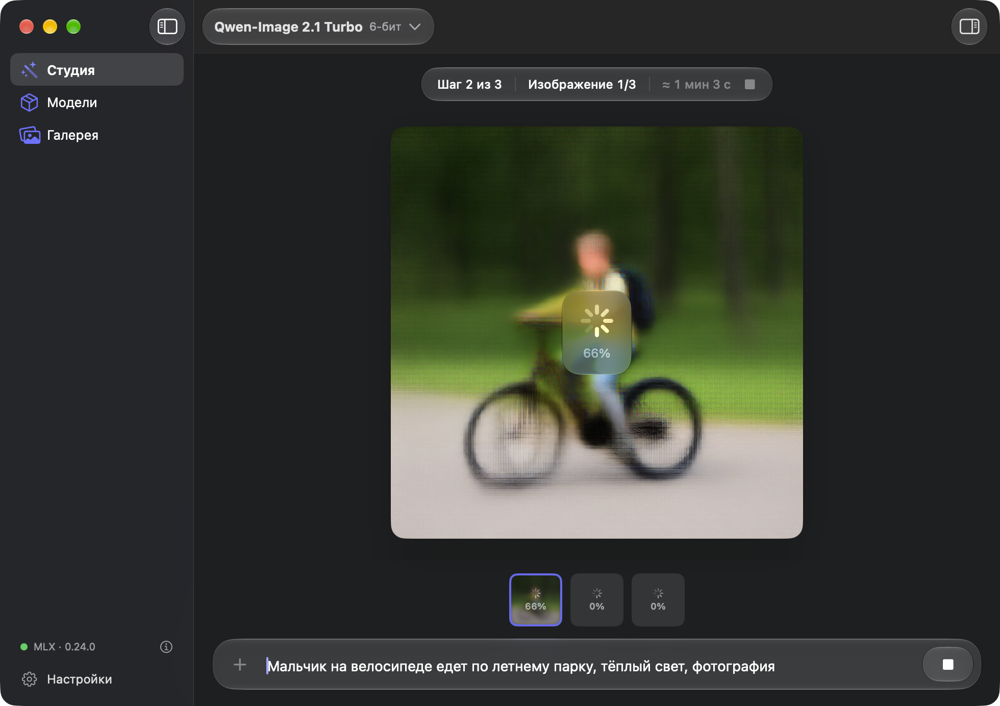
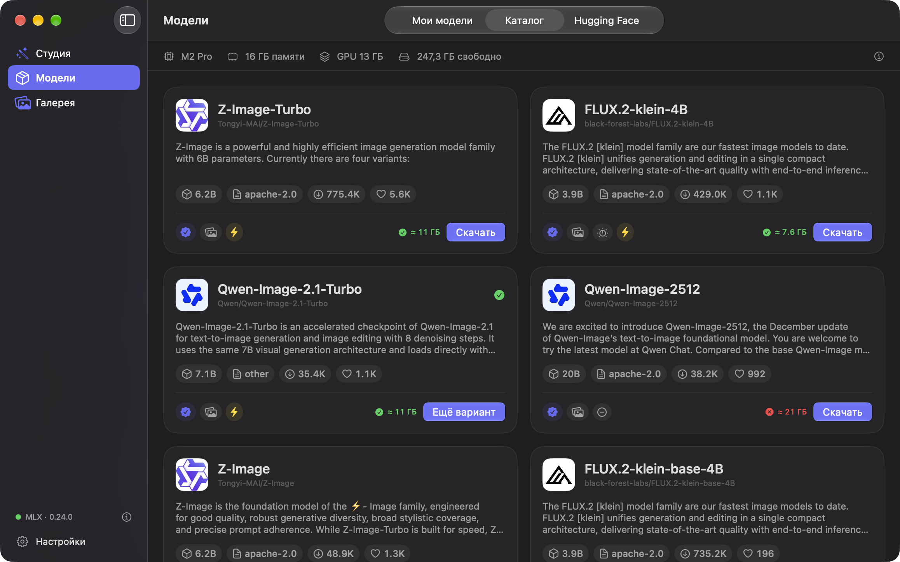
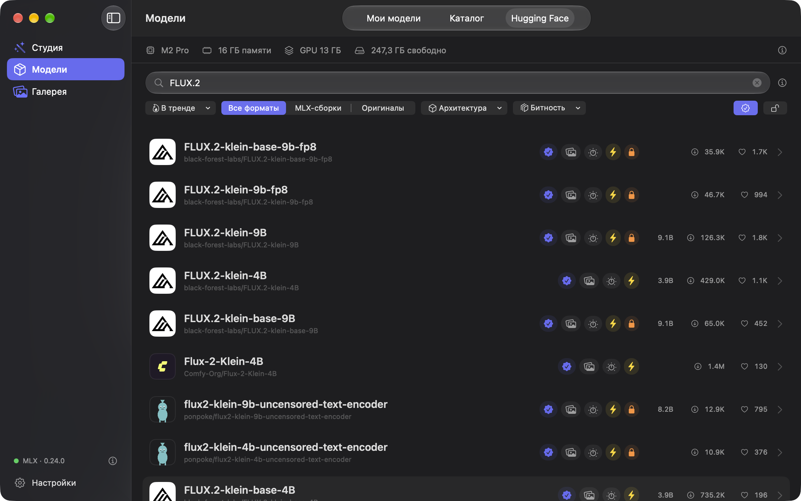

<h1 align="center">
  
</h1>

[English](README.md) · **Русский**

[](https://github.com/D1ma-coder/LocalImage/actions/workflows/ci.yml)
[](https://github.com/D1ma-coder/LocalImage/releases)
[](#установка)
[](LICENSE)

LocalImage — нативное приложение для macOS, которое генерирует изображения полностью на вашем Mac. Интерфейс написан на SwiftUI с Liquid Glass, движок — [mflux](https://github.com/filipstrand/mflux) на MLX от Apple. Промпты, изображения и модели не покидают компьютер.

Любую совместимую модель можно скачать с Hugging Face прямо в приложении, выбрать квантование и смотреть, как изображение проявляется на каждом шаге. Приложение рассчитано на Mac с 16 ГБ объединённой памяти: перед каждым запуском оно оценивает пик памяти и само выбирает безопасные настройки.

**[Установка](#установка) · [Первое изображение](#первое-изображение) · [Модели](#модели) · [16 ГБ памяти](#16-гб-памяти) · [Файлы](#где-хранятся-файлы) · [Сборка](#сборка-из-исходников)**

## Живое превью

На каждом шаге показывается оценка готового изображения (x̂₀), а не сырой шум, поэтому композиция видна уже с первого шага. До готовности холст слегка размыт и закрыт лоадером; для серии все места создаются сразу.



Все изображения сохраняются в `~/Pictures/LocalImage/ГГГГ-ММ-ДД/`, рядом с каждым — файл `.lix.json` с параметрами. В галерее есть поиск по промпту, любое изображение можно повторить с тем же или новым seed.

## Установка

Сборки публикуются в [Releases](https://github.com/D1ma-coder/LocalImage/releases) после сборки на CI:

| Платформа | Архив |
|---|---|
| macOS 26 и новее, Apple Silicon (M1 и новее) | `LocalImage-<версия>-macos-arm64.zip` |

1. Скачайте архив и распакуйте его.
2. Перенесите **LocalImage.app** в **Программы**.
3. Приложение не подписано Developer ID и не нотаризовано, поэтому macOS заблокирует первый запуск. Выполните

   ```sh
   xattr -dr com.apple.quarantine /Applications/LocalImage.app
   ```

   или откройте приложение один раз и нажмите **Всё равно открыть** в **Системные настройки → Конфиденциальность и безопасность**.

Контрольные суммы SHA-256 указаны в описании каждого релиза. Mac на Intel не поддерживаются: MLX работает только на Apple Silicon.

## Первое изображение

1. **Установите движок.** При первом запуске приложение предложит это сделать. [uv](https://github.com/astral-sh/uv) создаёт изолированное окружение Python 3.12 с закреплённой версией `mflux==0.24.0` в `~/Library/Application Support/LocalImage/engine`. Если uv не установлен, приложение скачает его из релизов на GitHub. В систему ничего не ставится.
2. **Скачайте модель.** Откройте **Модели → Каталог**. Для 16 ГБ хорошо подходят Z-Image Turbo (4 бита) или FLUX.2 klein 4B.
3. **Сгенерируйте.** Вернитесь в **Студию**, напишите промпт и нажмите **⌘↩**. **⌘.** мгновенно останавливает генерацию, **⇧⌘R** — новый seed.

Чтобы начать с готовой картинки, перетащите её на холст или нажмите **+** рядом с промптом; **Влияние исходника** в правой панели определяет, сколько от неё останется.

## Модели

- **Каталог.** Открытые модели с готовыми MLX-сборками (4/8 бит) от [mflux-community](https://huggingface.co/mflux-community): Z-Image, FLUX.2 klein, Qwen-Image 2.1, ERNIE-Image, Boogu, MOSS-Image, Iris, Anima и другие. Описания, лицензии, число параметров и скачиваний подгружаются с Hugging Face.
- **Поиск по Hugging Face.** Любой репозиторий, фильтры по формату (MLX-сборка / оригинал), архитектуре, битности, совместимости и закрытости. Значки в строке модели поясняют себя при наведении.
- **Оригинальные веса со своим квантованием.** Текстовый/VL-энкодер и диффузионная часть квантуются раздельно. Приложение подсказывает лучшие сочетания под память вашего Mac.
- **Загрузки** докачиваются через HTTP Range после обрывов сети и перезапуска приложения, по одному файлу. Качаются только нужные веса: дубли single-file чекпоинтов и картинки из репозитория пропускаются.



<details>
<summary>Поиск по Hugging Face</summary>



</details>

Токен Hugging Face необязателен. Он вводится в **Настройки → Hugging Face**, проверяется прямо при вводе и нужен только для закрытых моделей и повышенных лимитов API. Хранится в файле `~/Library/Application Support/LocalImage/hf_token` с правами 600, Связка ключей не используется.

## 16 ГБ памяти

- MLX загружает веса лениво, а текстовый энкодер выгружается до начала рисования, поэтому пики энкодера и диффузии не складываются.
- Оценка памяти в правой панели опирается на лимит рабочего набора GPU, который Metal сообщает для этого Mac.
- На M1/M2 вычисления идут во float16: на M2 Pro это примерно на 27% быстрее.
- Режим экономии памяти (mflux `--low-ram`) включается сам, когда оценка пика близка к пределу.
- Генерация и квантование никогда не идут одновременно.

Замер на M2 Pro с 16 ГБ, Z-Image Turbo 4 бита, 768×768, 9 шагов: 7.3 с/шаг во float16 (10.2 с/шаг в bfloat16), пик MLX — 4.6 ГБ.

## Где хранятся файлы

| Что | Где |
|---|---|
| Движок | `~/Library/Application Support/LocalImage/engine` |
| Модели | `~/Library/Application Support/LocalImage/models` (меняется в **Настройки → Папки**) |
| Изображения | `~/Pictures/LocalImage` (меняется в **Настройки → Папки**) |
| Токен Hugging Face | `~/Library/Application Support/LocalImage/hf_token` |
| Превью шагов | `$TMPDIR/LocalImagePreviews` |

## Как это устроено

```
LocalImage/
  App/        точка входа, AppModel
  Core/       пути, железо (рабочий набор Metal, ядра GPU), токен HF, форматирование
  Engine/     Engine (установка uv / venv / mflux), Worker (процесс и его события)
              lix_worker.py — мост к mflux, лежит в ресурсах приложения
  Models/     каталог, модель памяти и подбор квантования, клиент Hugging Face
  Downloads/  FileTransfer (докачка через Range), ModelStore (манифесты, очередь, квантование)
  Studio/     параметры генерации, задания, прогресс и оценка времени, галерея
  Views/      SwiftUI
```

Приложение запускает `python -I lix_worker.py <команда> <json>` на каждое задание. После задания память гарантированно освобождается, падение модели не роняет интерфейс, а отмена — это сигнал процессу воркера. Серия изображений генерируется с одной загрузкой модели.

Воркер пишет JSON-строки (`phase`, `denoise`, `step`, `preview`, `image`, `done`, `error`, `log`) в исходный stdout, а вывод mflux и tqdm уходит в stderr и становится журналом. Поверх mflux он добавляет колбэк превью, который декодирует x̂₀ = x − σ·(Δx/Δσ), раздельное квантование компонентов (текст / изображение / VAE) и команду `families`, сообщающую возможности каждой архитектуры, — интерфейс подстраивается под модель.

Версия mflux закреплена, потому что воркер использует его внутренние API. Перед обновлением прогоните `python lix_worker.py families` и короткую тестовую генерацию.

## Сборка из исходников

Нужен Xcode 26 или новее на Apple Silicon.

```sh
git clone https://github.com/D1ma-coder/LocalImage.git
cd LocalImage
xcodebuild -project LocalImage.xcodeproj -scheme LocalImage -configuration Release \
  -derivedDataPath build/DerivedData build
open build/DerivedData/Build/Products/Release/LocalImage.app
```

Или откройте `LocalImage.xcodeproj` в Xcode и нажмите **⌘R**. Новые файлы в `LocalImage/` подхватываются автоматически.

## Лицензия

[MIT](LICENSE). mflux распространяется по лицензии MIT. У каждой модели своя лицензия — она показана в каталоге и на странице модели на Hugging Face; проверьте её перед коммерческим использованием изображений.
